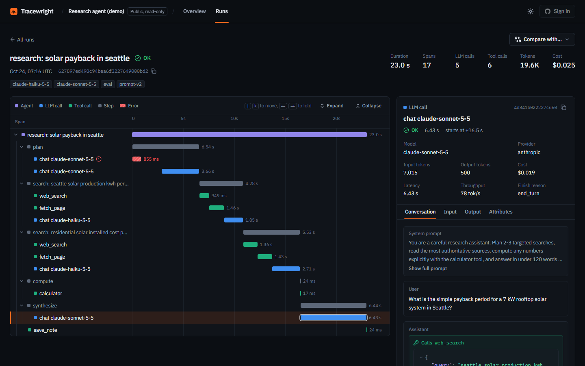
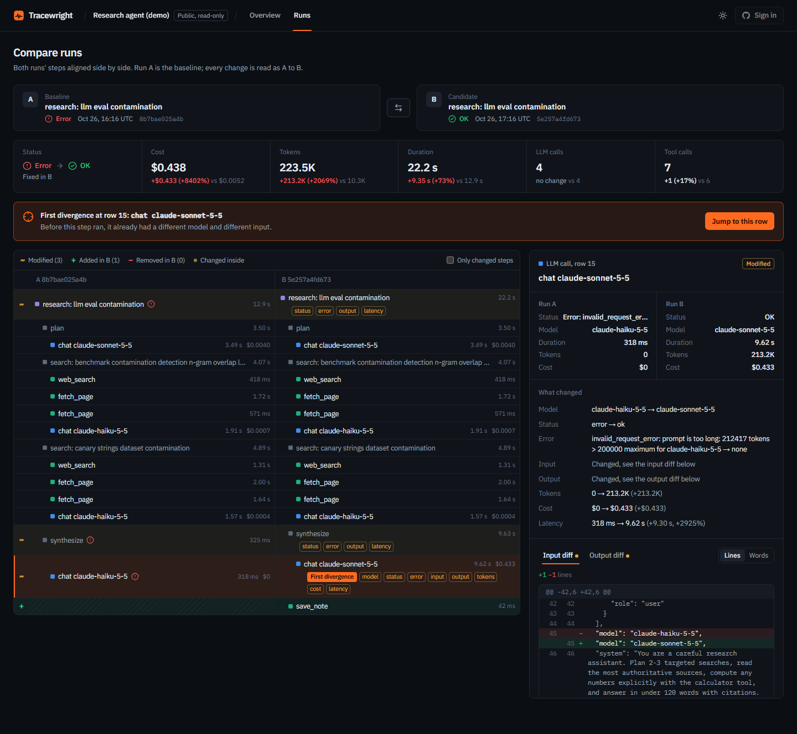
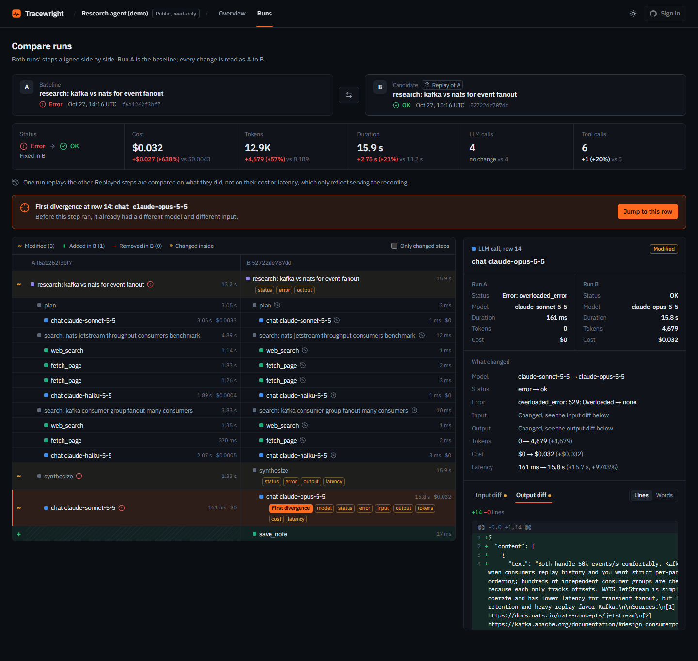
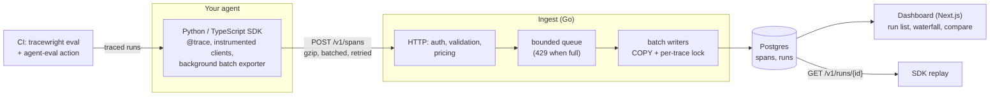

# Tracewright

A flight recorder for AI agents: record every LLM and tool call as a trace, then inspect,
diff, replay, and regression-test runs.



**Live demo: [tracewright-rosy.vercel.app](https://tracewright-rosy.vercel.app)** (public, read-only,
no sign-in). The demo project holds generated research-agent runs (`dashboard/scripts/seed.ts`),
including compare and replay pairs; it makes no live LLM calls, so it costs nothing to keep up.

## Why

Agents are nondeterministic, multi-step programs, so a prompt tweak or model swap can break
them in ways that logs don't explain. Tracewright records the shape of each run (which
step called which model or tool, with what input, at what cost) so you can see where two
runs diverged. Then it lets you re-run a recorded run with a fix, and gate pull requests on
an eval suite.

## Feature tour

**Inspect.** A waterfall of the run tree (agent → step → LLM/tool calls) with a span
inspector showing the full conversation, tokens, cost and latency. LLM spans follow the
OpenTelemetry GenAI conventions.

**Compare.** Two runs' span trees are aligned step by step, and the first divergence is
called out, with per-step deltas and input/output diffs.



**Replay.** `tracewright.replay(trace_id, from_step=3, overrides={...})` re-executes a
recorded run. Steps before 3 are served from the recording (no LLM calls, no tool side
effects); from step 3 the run goes live with a new model or prompt. Below, a replay that
swapped the model, next to the original: served steps cost $0, and the final call that
failed now succeeds.



**Regression-test.** `tracewright eval run` scores a task suite; `tracewright eval compare`
diffs it against a committed baseline and fails CI on regressions. A GitHub Action keeps
one PR comment up to date with the report:

<details>
<summary>Example PR comment: an agent change that adds one wasted tool loop per task</summary>

> **Regression.** 4 tasks newly failing (allowed: 0); 2 tasks over a per-task threshold;
> suite passed tasks, cost (total), tokens (total), steps (total) over threshold. 2/6 tasks pass.
>
> | task | change | baseline | current | steps | tokens | cost |
> |---|---|---|---|---|---|---|
> | `apollo-gap` | **newly failing** | pass | fail | **5 → 6** | 4,537 → 6,481 | **$0.01731 → $0.02370** |
> | `calculator-plain-numbers` | **newly failing** | pass | fail | **4 → 5** | 3,453 → 5,141 | **$0.01280 → $0.01846** |
> | `parallel-lookup` | **regressed** | pass | pass | **3 → 4** | 2,610 → 4,842 | **$0.01037 → $0.01803** |
> | ... | | | | | | |
>
> | metric | baseline | current | change | threshold |
> |---|---|---|---|---|
> | cost (total) | $0.09745 | $0.13976 | +$0.04231 (+43.4%) | **exceeded** (max +10%) |
> | tokens (total) | 23,202 | 34,674 | +11,472 (+49.4%) | **exceeded** (max +10%) |

Full report: [docs/example-regression-report.md](docs/example-regression-report.md)
</details>

## Architecture



Deployment target: Postgres on Neon, ingest on Fly.io, dashboard on Vercel
([docs/deploy.md](docs/deploy.md)).

## Engineering highlights

**Ingest throughput.** One ingest instance sustained **24,400 spans/s** (about 68 MB/s of
span JSON, LLM spans carrying 4–8 KB prompts) for 60 s. That was with no 429s, request
latency p50/p99 of **6 / 25 ms**, and every span in Postgres within **189 ms** (p99) of
leaving the client. Client, ingest and Postgres shared one 4-vCPU Docker VM, so the box,
not ingest, set the ceiling: about 26k spans/s with gzip, 32k without. The
[load test](docs/load-test.md) covers method, all six experiments, tuning and caveats,
with its own generator in [`ingest/cmd/loadgen`](ingest/cmd/loadgen).

**Backpressure instead of blocking.** Requests are validated, then admitted to a bounded
queue (span and byte budgets) or refused with `429 Retry-After`. Overload is visible to
clients and memory stays bounded. Writers `COPY` into a per-connection staging table, then
`INSERT ... ON CONFLICT DO NOTHING`, so ingest is idempotent and SDKs retry freely.

**The lost-update bug.** The per-run summary row is recomputed from all of a trace's spans
in the same transaction as the insert. Two writers flushing spans of the *same* trace at
once each recomputed from a snapshot missing the other's spans, and the later commit won
with stale totals. Each flush now takes a transaction-scoped advisory lock per trace, in
sorted order so writers can't deadlock. `TestConcurrentWritesToOneTrace` reproduces the
lost update without the lock.

**Run diff.** Two span trees are aligned top-down, matching only children of matched
parents, with a weighted sequence-alignment DP over each sibling list. The weights are
signature, content similarity, and subtree size. That keeps LCS's O(n·m) cost while
telling "same step, different model" apart from "different step". Plain LCS can't do
that, and Zhang–Shasha tree edit distance is costlier and can move a call to a different
parent. Identical subtrees take an
O(n) hash fast path, and long flat lists use a banded DP. Measured: a 2,041-span nested
diff in about **49 ms**, and a 2,000-sibling flat diff in **51 ms** banded vs 287 ms exact
([packages/run-diff](packages/run-diff/README.md)).

**Exporter batching under load.** The SDK exporter never blocks the agent: spans go onto
a bounded queue that a background thread ships in gzip batches. A size-triggered wakeup
used to drain the queue completely, so spans still being emitted went out in many small
requests under load. Now size wakeups ship only full batches, while the interval tick and
`flush()` ship the rest. `flush()` is a sticky flag consumed under the lock, so a request
can't be lost between the check and the wait.

**Replay matching.** Each live call is matched to the recording by its position within its
step plus a signature: `("llm", provider)`, or `("tool", name, arguments)`. The first
mismatch marks the replay as diverged, and everything after runs live rather than being
served stale data. Recorded errors are re-raised under their original type name, so agent
code formats them identically. Replaying the demo's failed calculator run from step 3 with
a one-line prompt fix served 4 calls from the recording, ran 3 live, and avoided the tool
error.

## Quickstart

Requires Docker and [uv](https://docs.astral.sh/uv/). Three commands, no API keys, no LLM
calls:

```sh
docker compose up -d --build
export TRACEWRIGHT_API_KEY=$(docker compose exec -T ingest tracewright-ingest admin create-project --slug demo --name Demo --public >/dev/null && docker compose exec -T ingest tracewright-ingest admin create-key --project demo)
cd examples/research-agent && uv run research-agent --scenario calculator-recovery
```

The agent prints its trace id; the run is now in Postgres
(`curl -H "Authorization: Bearer $TRACEWRIGHT_API_KEY" localhost:4318/v1/runs/<trace id>`).
To browse it, start the dashboard (`cd dashboard && pnpm install && pnpm dev`, then open
http://localhost:3000). To try replay and evals:

```sh
uv run research-agent --replay <trace id> --from-step 3 \
    --override-system-append "Write calculator expressions with plain numbers only."
uv run tracewright eval run evals/suite.yaml -o results.json
uv run tracewright eval compare --baseline evals/baseline.json --current results.json \
    --thresholds evals/thresholds.yaml
```

On Windows, clone to a short path (for example `C:\src`): one of the Anthropic SDK's
module paths is long enough to exceed the default 260-character path limit inside a deep
directory.

## Repository map

| path | what |
|---|---|
| [`ingest/`](ingest) | Go ingest service: HTTP API, bounded queue, batch writers, read API, admin CLI, load generator |
| [`sdk/python/`](sdk/python) | Python SDK: tracing, Anthropic/OpenAI instrumentation, replay, `tracewright eval` |
| [`sdk/typescript/`](sdk/typescript) | TypeScript SDK: tracing and instrumentation |
| [`packages/run-diff/`](packages/run-diff) | tree-aware run alignment and diff (TypeScript), used by the dashboard |
| [`dashboard/`](dashboard) | Next.js dashboard: run list, waterfall, compare, overview, GitHub sign-in |
| [`examples/research-agent/`](examples/research-agent) | demo agent with mock and real backends, plus its eval suite |
| [`docs/`](docs) | [spec](docs/spec.md), [wire contract](docs/contract.md), [load test](docs/load-test.md), [deploy](docs/deploy.md) |
| [`.github/`](.github) | CI, the agent-eval workflow, and a reusable eval action |

## Testing and CI

- **Go:** unit tests, plus integration tests against real Postgres (testcontainers),
  including an HTTP-to-Postgres end-to-end test and the concurrent-write regression test.
- **Python:** SDK unit tests (fake clients, an httpx mock of the read API for replay, and
  eval scorers/compare); the demo agent's tests include a replay end-to-end test against
  the Docker stack, which skips without it.
- **TypeScript:** vitest suites for the SDK and run-diff (scenarios, property tests,
  timed perf cases) and dashboard unit tests; Playwright end-to-end tests for the dashboard.
- **CI** ([`ci.yml`](.github/workflows/ci.yml)): path-filtered jobs per component, with
  lint, types, tests and build. [`agent-eval.yml`](.github/workflows/agent-eval.yml) runs
  the eval suite on PRs and comments the report.

## Roadmap

- Host ingest publicly (Fly.io config is ready in [docs/deploy.md](docs/deploy.md)) so the demo can receive live traces
- Streaming LLM calls in both SDKs' instrumentation
- Replay in the TypeScript SDK
- An LLM-as-judge scorer (the interface is stubbed)
- Span retention and time partitioning for large projects
- Dashboard end-to-end tests in CI
